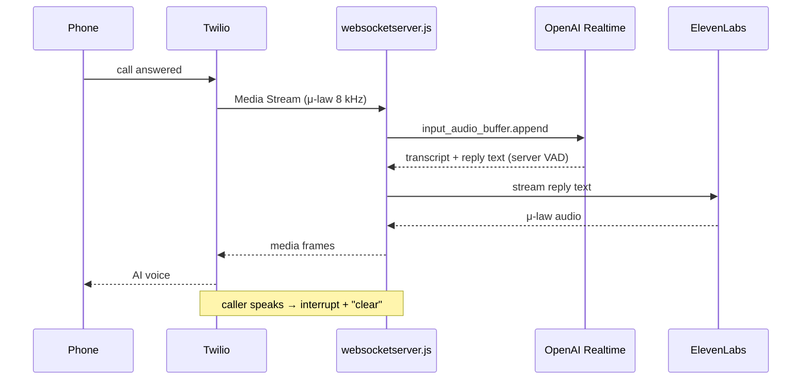
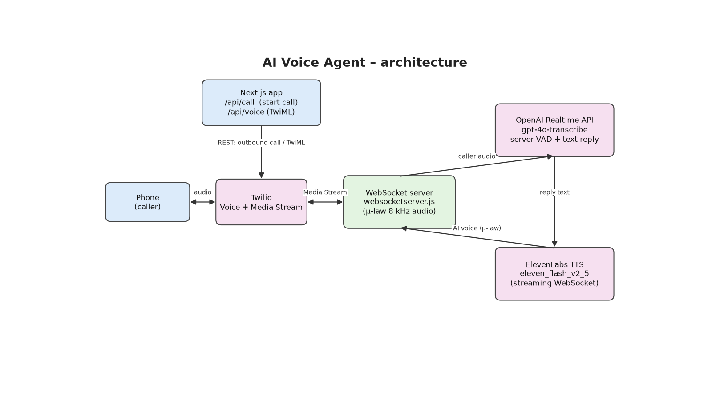

# AI Voice Agent

**An AI agent that calls a real phone number and holds a live, interruptible conversation in Dutch, by bridging Twilio, the OpenAI Realtime API and ElevenLabs over WebSockets.**

## Demo

> _Audio/video clip coming soon_
>
> `docs/demo-call.mp4`: screen recording of starting a call from the web UI, with the call audio

## Highlights

- **Real phone audio, end to end.** Raw G.711 μ-law (8 kHz, 20 ms frames) is streamed from Twilio Media Streams into the OpenAI Realtime API and back, without saving or converting files during the call.
- **Low-latency speech pipeline.** `gpt-4o-transcribe` does speech-to-text, server-side VAD detects when the caller stops talking, and the reply text streams into the ElevenLabs multi-stream-input WebSocket (`eleven_flash_v2_5`), which returns μ-law audio straight into the call.
- **Barge-in / interruptions.** When the caller starts talking, the agent's response is interrupted (`interrupt_response`) and Twilio's audio buffer is cleared, so the agent stops speaking immediately.
- **Configurable persona.** System instructions and voice are set per session (`session.update`). The current demo persona is a warm, supportive conversation partner in Dutch.
- **Outbound calling from a web UI.** A Next.js page starts the call through the Twilio REST API, and TwiML webhooks connect it to the media stream.

## How it works





1. The Next.js app starts an outbound call through the **Twilio REST API** (`/api/call`).
2. When the call is answered, Twilio requests TwiML from `/api/voice`, which connects the call to a **Media Stream** on the WebSocket server.
3. Caller audio is forwarded to the **OpenAI Realtime API**, which transcribes it, detects end of speech and generates a reply.
4. The reply streams to **ElevenLabs**, and the returned μ-law audio is sent straight back into the call.
5. If the caller interrupts, the agent's response is cancelled and the outgoing audio buffer is cleared.

## Tech stack

| Part | Technology |
|---|---|
| App & API routes | Next.js 15 (App Router), React 19, Tailwind CSS |
| Telephony | Twilio Programmable Voice, TwiML, Media Streams |
| Speech-to-text & LLM | OpenAI Realtime API (`gpt-4o-transcribe`, server VAD) |
| Text-to-speech | ElevenLabs streaming WebSocket API (`eleven_flash_v2_5`) |
| Real-time transport | `ws` WebSocket server |
| Audio conversion | ffmpeg (post-call) |

## Project structure

```
app/page.js               # simple UI to enter a number and start a call
app/api/call/route.js     # starts an outbound call via Twilio
app/api/voice/route.js    # TwiML: connect the call to the media stream
app/api/next/route.js     # TwiML helper used between conversation turns
app/api/status/route.js   # Twilio call status callbacks
app/api/welcome/route.js  # generates a welcome message with OpenAI TTS
websocketserver.js        # real-time bridge: Twilio ⇄ OpenAI Realtime ⇄ ElevenLabs
testElevenlabs.js         # standalone ElevenLabs streaming test
```

## Getting started

Requirements: Node.js 20+, ffmpeg, a Twilio account with a phone number, and OpenAI and ElevenLabs API keys.

```bash
npm install
cp .env.example .env     # fill in your keys
node websocketserver.js  # WebSocket server on port 8080
npm run dev              # Next.js app on http://localhost:3000
```

Twilio must be able to reach both servers, so expose them publicly (for example with ngrok) and put the URLs in `MY_DOMAIN` and `MY_WEBSOCKET`.

## What I learned

- Working with raw telephone audio: μ-law encoding, 8 kHz sample rates and 20 ms frames
- Bridging three real-time WebSocket APIs while keeping latency low
- Turn-taking in voice conversations: voice activity detection and handling interruptions
- How Twilio drives a call with TwiML and webhooks
